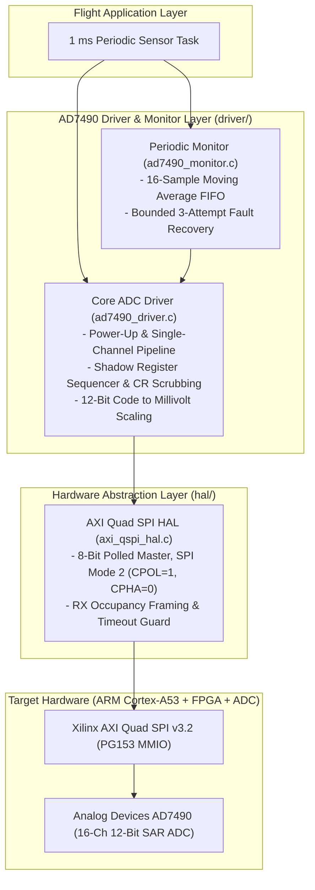

# AD7490 Safety-Critical Bare-Metal Driver & Periodic Monitor (Xilinx AXI Quad SPI, ARM Cortex-A53)

A high-reliability, safety-critical bare-metal C99 driver and periodic monitoring stack for the **Analog Devices AD7490** (16-channel, 12-bit, 1 MSPS SAR ADC) interfaced through a **Xilinx LogiCORE IP AXI Quad SPI v3.2 (PG153)** controller on an **ARM Cortex-A53** processor.

Developed and verified to **DO-178C DAL A**, **MISRA C:2012**, and **BARR-C:2018** standards as unified in [`docs/C_rules_v3_addDO178C.md`](docs/C_rules_v3_addDO178C.md).

---

## 1. Project Highlights

- **Complete Hardware-to-Application Stack:**
  - **AXI Quad SPI HAL (`hal/axi_qspi_hal.*`):** Polled 8-bit master driver for Xilinx PG153 (`ACLK = 100 MHz`, `16x1` prescaler $\rightarrow$ `SCK = 6.25 MHz`, 256-byte FIFOs, manual `SS0` framing based on true RX FIFO occupancy).
  - **AD7490 Core Driver (`driver/ad7490_driver.*`):** Implements the Figure 16 power-up dummy-frame sequence (`2 x 0xFFFF`), pipelined single-channel conversions (2 frames in `NORMAL`, 3 frames with a power-up dummy in `AUTO_STANDBY`/`AUTO_SHUTDOWN`), power management modes (`NORMAL`, `FULL_SHUTDOWN`, `AUTO_STANDBY`, `AUTO_SHUTDOWN`), Shadow Register channel sequencer (`VIN0 = MSB`), online Control Register scrubbing (`SEQ=1, SHADOW=0`), and overflow-proof fixed-point millivolt conversion (`0..5050 mV`).
  - **Periodic 1 ms Monitor (`driver/ad7490_monitor.*`):** Performs periodic sequenced scans, maintains a self-healing 16-sample moving-average ring buffer per channel (no cached running sum to prevent SEU drift), and executes bounded fault recovery (maximum 3 verified re-configuration attempts per fault episode before latching `AD7490_ERR_DEVICE_FAILED`).
- **Full DO-178C DAL A Certification Artefact Suite (`docs/`):**
  - Low-Level Requirements Specification ([`docs/LOW_LEVEL_REQUIREMENTS.md`](docs/LOW_LEVEL_REQUIREMENTS.md))
  - Software Design Description ([`docs/SOFTWARE_DESIGN_DESCRIPTION.md`](docs/SOFTWARE_DESIGN_DESCRIPTION.md))
  - Bi-Directional Traceability Matrix ([`docs/TRACEABILITY_MATRIX.md`](docs/TRACEABILITY_MATRIX.md))
  - Software Verification & Unit Test Report ([`docs/TEST_REPORT.md`](docs/TEST_REPORT.md))
  - MISRA Deviation & DO-178C Defensive Code Log ([`docs/DEVIATION_AND_DEFENSIVE_LOG.md`](docs/DEVIATION_AND_DEFENSIVE_LOG.md))

---

## 2. System Architecture



---

## 3. Repository Directory Structure

```text
.
├── README.md                              # Project introduction, architecture & build guide
├── AGENTS.md                              # Structured guide for AI agents & automated auditors
├── Makefile                               # Cortex-A53 build, stack analysis, host tests, gcovr, style
├── .github/workflows/ci.yml               # GitHub Actions CI pipeline
├── .editorconfig                          # Editor formatting enforcement (4 spaces, LF, 80 cols)
├── .gitattributes                         # Enforces LF line endings across platforms
├── .gitignore                             # Ignores build/ and coverage artefacts
├── hal/
│   ├── axi_qspi_hal.h                     # Public API for Xilinx AXI Quad SPI v3.2 HAL
│   └── axi_qspi_hal.c                     # Polled 8-bit QSPI HAL implementation
├── driver/
│   ├── ad7490_driver.h                    # Public API for AD7490 driver
│   ├── ad7490_driver.c                    # AD7490 driver implementation
│   ├── ad7490_monitor.h                   # Public API for 1 ms periodic monitor & moving average
│   └── ad7490_monitor.c                   # Periodic monitor & 3-attempt recovery implementation
├── examples/
│   └── ad7490_scan16_raw.c                # Example: 16-channel scan + 16-sample raw FIFO per channel
├── test/
│   ├── check_style.awk                    # Automated Rule 0 & Allman brace checker
│   ├── test_common.h, test_common.c       # Unit-test harness & ASSERT() contract hook
│   ├── fake_ad7490.h, fake_ad7490.c       # 1-frame pipeline AD7490 behavioural model & fault injector
│   ├── test_qspi_hal.c                    # Unit tests for hal/axi_qspi_hal.c
│   ├── test_frame_convert.c               # Frame encoding & 835,584 exhaustive conversion tests
│   ├── test_device.c                      # Init, single-channel read & power mode tests
│   ├── test_sequencer.c                   # Shadow Register sequencer & CR scrubbing tests
│   └── test_monitor.c                     # Moving average window & 3-attempt fault recovery tests
├── docs/
│   ├── C_rules_v3_addDO178C.md            # Unified MISRA C:2012 + BARR-C:2018 + DO-178C DAL A rules
│   ├── AD7490.PDF                         # Analog Devices AD7490 hardware datasheet
│   ├── LOW_LEVEL_REQUIREMENTS.md          # Complete LLR specification (LLR-QSPI-* & LLR-AD7490-*)
│   ├── SOFTWARE_DESIGN_DESCRIPTION.md     # Complete SDD specification (SDD-QSPI-* & SDD-AD7490-*)
│   ├── TRACEABILITY_MATRIX.md             # Bi-directional traceability (@req <-> @design <-> code <-> tests)
│   ├── TEST_REPORT.md                     # Unit test & structural coverage verification report
│   └── DEVIATION_AND_DEFENSIVE_LOG.md     # MISRA deviations, defensive branches & SEU Hamming distances
└── scripts/
    ├── verify_compliance.py               # Cross-platform Python 3 compliance & traceability verifier
    └── verify_compliance.ps1              # Windows PowerShell compliance & traceability verifier
```

---

## 4. Quick-Start API Usage

### 4.1 Single-Channel On-Demand Conversion
```c
#include "ad7490_driver.h"

static ad7490_dev_t g_adc_dev;

ad7490_status_t read_vin5_mv(uint32_t * p_vin5_mv)
{
    ad7490_config_t const cfg = {
        .qspi_cfg = {
            .base_addr       = 0xA0000000U,
            .clock_mode      = AD7490_QSPI_CLOCK_MODE, /* Mode 2: CPOL=1, CPHA=0 */
            .poll_timeout_us = 10U
        },
        .vref_mv = 2500U,
        .ctrl_cfg = {
            .power_mode = AD7490_POWER_NORMAL,
            .range_mode = AD7490_RANGE_2X_VREF,        /* 0 .. 5000 mV */
            .coding     = AD7490_CODING_STRAIGHT_BINARY,
            .dout_mode  = AD7490_DOUT_TRI_STATE
        }
    };
    ad7490_sample_t sample = { 0U, 0U, 0U };
    ad7490_status_t status = ad7490_init(&g_adc_dev, &cfg);

    if (AD7490_OK == status)
    {
        status = ad7490_read_channel(&g_adc_dev, 5U, &sample);
    }

    if (AD7490_OK == status)
    {
        *p_vin5_mv = sample.voltage_mv;
    }

    return status;
}
```

### 4.2 Periodic 1 ms Sequenced Monitoring with Moving Average & Auto-Recovery
```c
#include "ad7490_monitor.h"

/* Allocate in static storage (~1.5 KB, per Rule §8 stack budget <= 64 B) */
static ad7490_monitor_t g_adc_mon;

/* Called once at startup to monitor VIN0 and VIN1 (mask = 0x0003U) */
ad7490_status_t sensor_monitor_setup(ad7490_config_t const * p_cfg)
{
    return ad7490_monitor_init(&g_adc_mon, p_cfg, 0x0003U);
}

/* Called every 1 ms from the periodic acquisition task */
ad7490_status_t sensor_monitor_1ms_task(uint32_t * p_vin0_avg_mv,
                                        size_t * p_sample_count)
{
    ad7490_status_t status = ad7490_monitor_step(&g_adc_mon);

    if (AD7490_OK == status)
    {
        status = ad7490_monitor_get_avg(&g_adc_mon,
                                        0U,
                                        p_vin0_avg_mv,
                                        p_sample_count);
    }

    return status;
}
```

### 4.3 One Scan of All 16 Channels with a 16-Sample Raw FIFO per Channel

Full example: [`examples/ad7490_scan16_raw.c`](examples/ad7490_scan16_raw.c).
It keeps **raw codes** (`DOUT[11:0]`, `0..4095`), not millivolts, so the
application can monitor and scale them itself. Per channel it holds the newest
code plus a **16-deep FIFO**; every new code pushes the oldest one out. One
`scan16_step()` runs one sequencer pass of 16 frames (~41 us at `SCK = 6.25 MHz`),
so calling it every 1 ms is comfortable.

```c
#include "ad7490_driver.h"

static scan16_state_t g_scan;          /* ~1 kB: never on the stack */

void app_init(void)
{
    ad7490_config_t const cfg = { /* as in 4.1 */ };

    if (AD7490_OK != scan16_start(&g_scan, &cfg))
    {
        /* ADC power-up or sequencer start failed */
    }
}

void task_1ms(void)                    /* periodic task, NOT an ISR */
{
    if (AD7490_OK != scan16_step(&g_scan))
    {
        /* Failed pass: every FIFO was emptied, so no mean mixes
           samples from before and after the fault. Recover with
           scan16_start(). */
    }
}

void app_monitor(void)
{
    uint16_t raw_lsb[AD7490_CHANNEL_COUNT] = { 0U };
    uint16_t window_raw[16] = { 0U };
    uint16_t avg_raw = 0U;
    size_t   fill_count = 0U;

    /* Newest code of every channel, indexed by channel ID */
    (void)scan16_get_last_raw(&g_scan, raw_lsb, AD7490_CHANNEL_COUNT);

    /* Mean of the codes currently in VIN5's FIFO (1..16 samples) */
    (void)scan16_get_avg_raw(&g_scan, 5U, &avg_raw, &fill_count);

    /* The whole FIFO of VIN5, oldest code first */
    (void)scan16_get_window(&g_scan, 5U, window_raw, 16U, &fill_count);
}
```

The mean covers only the codes actually stored, so the first 15 scans are not
diluted by empty slots. To get millivolts at the pin from a code, use the same
scaling the driver uses: `voltage_mv = (raw_lsb * span_mv + 2048) / 4096`, with
`span_mv = 2 x vref_mv` (`RANGE = 0`) or `vref_mv` (`RANGE = 1`). Multiply by
your divider ratio afterwards if the input is attenuated.

---

## 5. Build, Test & Verification Instructions

### 5.1 Automated Rule & Bi-Directional Traceability Audit (No Compiler Required)
Verifies all 15 `.c`/`.h` files and all certification documents in `docs/` against [`docs/C_rules_v3_addDO178C.md`](docs/C_rules_v3_addDO178C.md):

```bash
# Python 3 (Linux / macOS / Windows)
python3 scripts/verify_compliance.py
```

```powershell
# Windows PowerShell (zero external dependencies)
powershell -ExecutionPolicy Bypass -File scripts/verify_compliance.ps1
```

### 5.2 Host Unit Tests, Style Check & Structural Coverage (`gcovr`)
```bash
# Run Rule 0 style verification (80 columns, no //, no tabs, Allman braces)
make style

# Build and run all 5 host unit-test suites (including 835,584 exhaustive ADC conversions)
make test

# Generate console + HTML line and branch coverage report in build/coverage/index.html
make coverage

# MC/DC condition coverage with GCC 14 -fcondition-coverage (needs gcc-14, gcovr >= 8)
make mcdc
```

### 5.3 Cross-Compile Cortex-A53 Static Library & Verify Worst-Case Stack Usage
```bash
# Bare-metal Vitis / GNU Arm toolchain (default: aarch64-none-elf-)
make target
make stack

# Or with Linux GNU AArch64 cross-compiler
make target CROSS_COMPILE=aarch64-linux-gnu-
make stack  CROSS_COMPILE=aarch64-linux-gnu-
```

---

## 6. Certification & Design Documentation Index

| Document | Standard / Reference | Description |
|:---|:---|:---|
| [`docs/C_rules_v3_addDO178C.md`](docs/C_rules_v3_addDO178C.md) | MISRA C:2012 + BARR-C:2018 + DO-178C | Authoritative coding rules enforced across the repository. |
| [`docs/AD7490.PDF`](docs/AD7490.PDF) | Analog Devices Datasheet | Hardware specification for the AD7490 16-channel 12-bit SAR ADC. |
| [`docs/LOW_LEVEL_REQUIREMENTS.md`](docs/LOW_LEVEL_REQUIREMENTS.md) | DO-178C §5.1, §11.8 | Specification of all 63 Low-Level Requirements (`LLR-QSPI-*`, `LLR-AD7490-*`). |
| [`docs/SOFTWARE_DESIGN_DESCRIPTION.md`](docs/SOFTWARE_DESIGN_DESCRIPTION.md) | DO-178C §5.2, §11.9 | Software architecture, state machines, algorithms, WCET and WCSU bounds (`SDD-*`). |
| [`docs/TRACEABILITY_MATRIX.md`](docs/TRACEABILITY_MATRIX.md) | DO-178C §5.5, Table A-5 | Complete bi-directional mapping between LLR, SDD, source code, and unit tests. |
| [`docs/TEST_REPORT.md`](docs/TEST_REPORT.md) | DO-178C §6.4, §11.14 | Unit test results, fault-injection scenarios, and structural coverage report. |
| [`docs/DEVIATION_AND_DEFENSIVE_LOG.md`](docs/DEVIATION_AND_DEFENSIVE_LOG.md) | MISRA Compliance:2020 & DO-178C §6.4.4.3 | Formal record of MISRA deviations, defensive branches, and SEU Hamming distances. |
