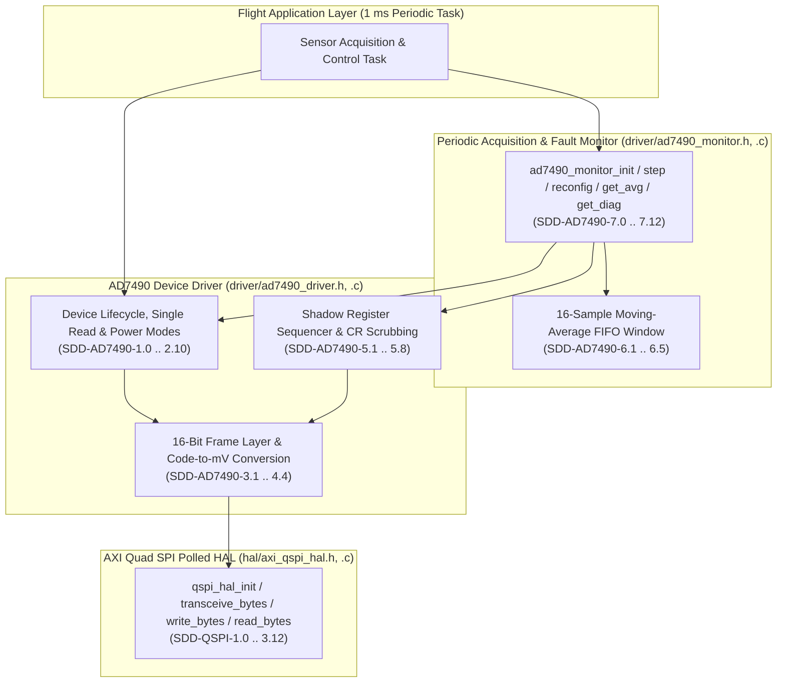
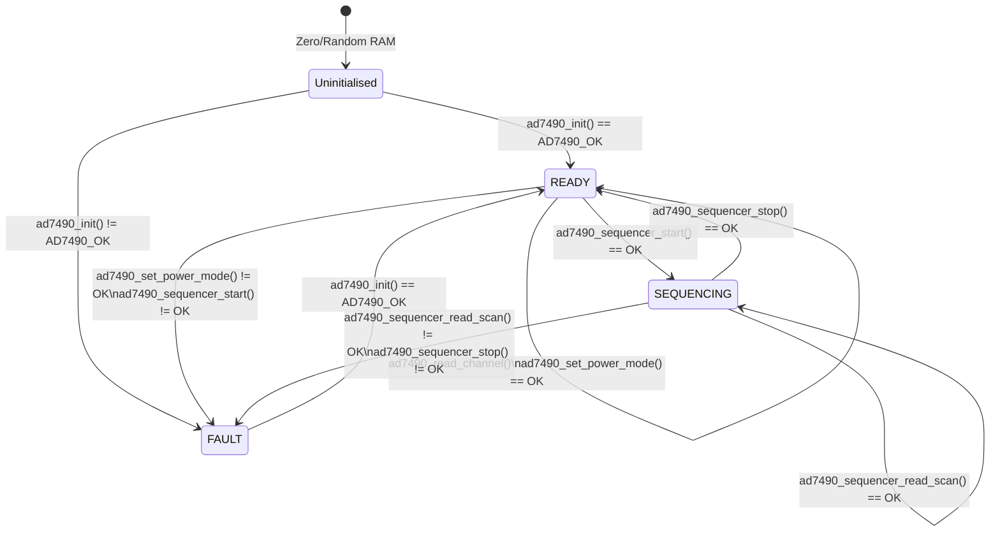
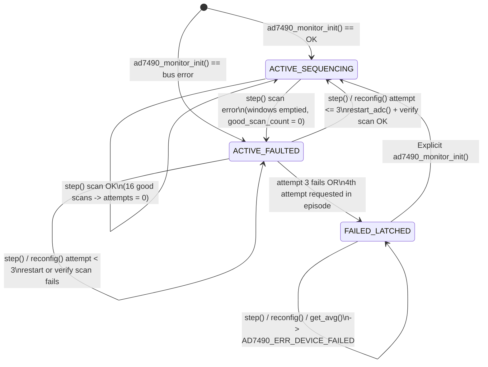

# Software Design Description (SDD — DO-178C §5.2, §11.9)

**Project:** AD7490 16-Channel 12-Bit SAR ADC Bare-Metal Driver & Periodic Monitor
**Target Processor:** ARM Cortex-A53 (64-bit ARMv8-A, Bare-Metal, `-mcpu=cortex-a53 -ffreestanding`)
**SPI Controller IP:** Xilinx LogiCORE IP AXI Quad SPI v3.2 (`PG153`)
**ADC Device:** Analog Devices AD7490 ([`docs/AD7490.PDF`](AD7490.PDF))
**Coding Standard:** [`docs/C_rules_v3_addDO178C.md`](C_rules_v3_addDO178C.md) (DO-178C DAL A + MISRA C:2012 + BARR-C:2018)

---

## 1. Software Architecture & Partitioning

The software is partitioned into three strictly layered, stateless/caller-handle C99 modules with **zero shared global variables (`extern`)** across module boundaries (`[DO §6.4.4.2, Table A-7]`):

### 1.1 Data and Control Coupling Design (`Rule §3`)
1. **Zero Global State:** All device state resides in caller-allocated handles (`ad7490_dev_t`, `ad7490_monitor_t`).
2. **Minimal Data Coupling:**
   - `ad7490_ctrl_cfg_t` (`SDD-AD7490-1.8`) isolates the 4 Control Register fields (`power_mode`, `range_mode`, `coding`, `dout_mode`) from bus and reference-voltage configuration so `build_cr_frame()` and `encode_cr_word()` only receive the sub-struct they actually encode.
   - `frame_bytes_t` (`SDD-AD7490-3.8`) wraps `uint8_t bytes[2]` by value so `frame_to_bytes()` and `bytes_to_frame()` exchange wire bytes without pointer aliasing or length arguments.
3. **Minimal Control Coupling:**
   - Rather than passing boolean selector flags (`bool is_seq`, `bool is_shadow`) into frame builders, `ad7490_seq_mode_t` (`SDD-AD7490-3.13`) defines one dedicated enumerator per row of AD7490 Table IV (`SINGLE`, `LOAD_SHADOW`, `KEEP_SEQ`, `CONSECUTIVE`), mapped via the compile-time constant table `seq_mode_cr_bits[]` (`SDD-AD7490-3.12`).

---

## 2. AXI Quad SPI HAL Design (`SDD-QSPI-*`)

### 2.1 Hardware Configuration & Memory Ordering (`SDD-QSPI-1.0` .. `1.4`)
- **`SDD-QSPI-1.0`**: Targets Xilinx AXI Quad SPI v3.2 configured for Standard SPI, 8-bit width, `ACLK = 100 MHz`, prescaler `16x1` (`SCK = 6.25 MHz`), 256-byte FIFOs, and manual slave select (`SS0`). The MMIO region must be mapped as ARMv8 `Device-nGnRE` (non-Gathering, non-Reordering, No Early Write Acknowledgement), guaranteeing that register reads and writes arrive at the peripheral in exact program order without requiring explicit `DMB` instructions between same-peripheral accesses.
- **`SDD-QSPI-1.1` .. `1.4`**: Defines `qspi_hal_status_t`, `qspi_clock_mode_t`, `qspi_hal_config_t`, and the contract macro `ASSERT(expr)`.

### 2.2 Public Operations (`SDD-QSPI-2.1` .. `2.4`)
- **`SDD-QSPI-2.1` (`qspi_hal_init`)**: Validates `p_cfg` (`SDD-QSPI-3.3`), triggers the `16-ACLK` software reset (`SRR = 0x0000000AU`), waits 32 AXI reads (`SDD-QSPI-3.9`), verifies `SPICR == 0x00000180U`, disables IP interrupts (`GIER = 0U`), drives `SS0` high (`SPISSR = 0xFFFFFFFFU`), resets TX/RX FIFOs while Master Inhibit is set, writes the idle control word, and verifies `SPISR.MODF == 0`.
- **`SDD-QSPI-2.2` (`qspi_hal_transceive_bytes`)**: Validates configuration, byte count (`1..256`), and non-`NULL` TX/RX pointers; flushes FIFOs (`SDD-QSPI-3.6`); queues `p_tx_bytes` (`SDD-QSPI-3.10`); executes the bus cycle (`SDD-QSPI-3.7`); and drains `byte_count` received bytes (`SDD-QSPI-3.8`) only if the bus cycle returned `QSPI_HAL_OK`. The drain writes `p_rx_bytes` in place and does not buffer the frame, so a drain aborted by `QSPI_HAL_ERR_HW` leaves a partially written array: `p_rx_bytes` is valid only when the function itself returns `QSPI_HAL_OK`, and the caller (`txrx_frame`, `read_frame`, `SDD-AD7490-3.4`, `3.5`) deserialises it on that condition only. Buffering the frame to roll a partial drain back would need a 256-byte local array, which `Rule §8` forbids on the stack (`> 64 B`), so the contract is stated instead of rolled back.
- **`SDD-QSPI-2.3` (`qspi_hal_write_bytes`)**: Same as `SDD-QSPI-2.2` without draining the RX FIFO (received bytes are discarded by the FIFO reset at the start of the next transaction).
- **`SDD-QSPI-2.4` (`qspi_hal_read_bytes`)**: Same as `SDD-QSPI-2.2`, using `load_tx_fifo_fill()` (`SDD-QSPI-3.11`) to drive `dummy_tx_byte` repeatedly on MOSI.

### 2.3 Private HAL Helpers & Timing Proof (`SDD-QSPI-3.1` .. `3.12`)
- **`SDD-QSPI-3.1`, `3.2` (`reg_write32`, `reg_read32`)**: The only two places in the entire codebase performing integer-to-pointer casts (`Rule §1, §9`, Deviations `DEV-QSPI-001`, `DEV-QSPI-002`).
- **`SDD-QSPI-3.3`, `3.4` (`is_hal_cfg_ok`, `is_byte_count_ok`)**: Decision chains structured as `if / else if / else` with exactly one atomic boolean condition per branch so every condition has an independent MC/DC pair.
- **`SDD-QSPI-3.5` (`clock_mode_ctrl_bits`, `build_control_word`)**: Table-driven mapping from `qspi_clock_mode_t` to `SPICR` `CPOL`/`CPHA` bits, with a defensive `else` (`DEF-QSPI-001`).
- **`SDD-QSPI-3.6` (`reset_fifos`)**: Pulses `TX_RESET | RX_RESET` in `SPICR` while `INHIBIT = 1` and `SS0 = 1`.
- **`SDD-QSPI-3.7` (`run_bus_cycle`)**:
  - **Framing Invariant:** Asserts `SS0` (`0xFFFFFFFEU`) immediately before clearing `INHIBIT`, and re-sets `INHIBIT` before deasserting `SS0` (`0xFFFFFFFFU`), ensuring all `byte_count` bytes are clocked under a single continuous `CS` low pulse.
  - **Completion Criterion:** Never polls `SPISR.Tx_Empty` (which asserts as soon as the last byte moves from the TX FIFO into the shift register while 8 `SCK` cycles are still in flight). Instead, polls `read_rx_count()` (`SDD-QSPI-3.12`) until `rx_count >= byte_count`, which occurs only after the final bit of the final byte has shifted in.
  - **Deterministic Timeout Bound:** Every poll iteration issues at least one AXI4-Lite read ($\ge 1\text{ ACLK} = 10\text{ ns}$ at $100\text{ MHz}$). Multiplying `timeout_us * 100U` (`QSPI_POLL_ITERS_PER_US`) guarantees that the loop waits *at least* `timeout_us` microseconds before timing out, with worst-case product $10^6 \times 100 = 10^8 < 2^{32}$ (zero unsigned wrap-around).
  - **Post-Cycle Hardware Verification:** Reads back `SPISSR` (flushing the posted deassert write and verifying `SS0` is physically high) and `SPISR` (verifying `MODF == 0`).
- **`SDD-QSPI-3.6` (`reset_fifos`)**: Asserts `TX_RESET | RX_RESET` in `SPICR` while Master Inhibit is set, **holds them for `QSPI_RESET_SETTLE_READS` (32) AXI reads**, then clears them. The hold is required by the hardware and is not optional: with the two `SPICR` writes back to back the reset pulse is shorter than the IP reset pulse (16 ACLK) and the FIFO reset does not complete. Nothing observable reports this — the reset bits read back clear and both FIFOs read empty straight away — but the TX FIFO then silently drops the first byte written to `SPIDTR`, so the transfer ends as `QSPI_HAL_ERR_TIMEOUT` (RX never reaches `byte_count`). Measured on an AXI Quad SPI v3.2 (`ACLK = 100 MHz`, Frequency Ratio `16x1`, FIFO depth 256, 8-bit, 1 slave): one AXI read between the two writes already suffices, and a delay placed *after* the clearing write does not help, which identifies the pulse width — not the write spacing — as the constraint. The 32-read margin is the same constant the `SRR` reset uses (`SDD-QSPI-3.9`).
- **`SDD-QSPI-3.8` .. `3.12`**: `drain_rx_bytes()`, `wait_reset_done()` (32 AXI reads of `SPICR` covering $2 \times 16\text{ ACLK}$ reset pulse), `load_tx_fifo_array()`, `load_tx_fifo_fill()`, and `read_rx_count()` (`(RXOCY & 0xFFU) + 1U` when `RX_EMPTY == 0`).

---

## 3. AD7490 Driver Design (`SDD-AD7490-1.0` .. `5.8`)

### 3.1 Device State Machine & SEU Protection (`SDD-AD7490-1.0` .. `1.10`)
- **`SDD-AD7490-1.9` (`ad7490_dev_state_t`)**: Uses 32-bit state patterns with pairwise Hamming distance $\ge 20$:
  - `AD7490_STATE_READY = 0x5A3C96E1U`
  - `AD7490_STATE_SEQUENCING = 0x3CA5E196U`
  - `AD7490_STATE_FAULT = 0xC35A693CU`

### 3.2 Device Lifecycle, Single Read & Power Modes (`SDD-AD7490-2.1` .. `2.12`)
- **`SDD-AD7490-2.1`, `2.6`, `2.7` (`ad7490_init`, `is_dev_cfg_ok`, `run_power_up`)**:
  - Pessimistically sets `p_dev->state = AD7490_STATE_FAULT` upon entry.
  - Validates `vref_mv` (`2475..2525 mV`), `clock_mode == QSPI_CLOCK_MODE_2` (`CPOL=1, CPHA=0`), `poll_timeout_us >= 3U` ($16 \times 160\text{ ns} = 2.56\text{ }\mu\text{s}$), and `ctrl_cfg` before touching the QSPI peripheral.
  - Executes the datasheet Figure 16 power-up sequence: QSPI IP reset + 2 dummy frames with `DIN = 0xFFFFU` + 1 Control Register configuration frame.
- **`SDD-AD7490-2.2`, `2.8`, `2.9` (`ad7490_read_channel`, `read_single`, `decode_sample`)**:
  - **1-Frame Conversion Pipeline:** The AD7490 samples and converts in Frame $N$ the channel selected by `ADD3..ADD0` at the end of Frame $N-1$.
  - Frame 1 (`write_frame`) always writes the CR with `ADD3..ADD0 = channel_id`; its DOUT is ignored. What follows depends on the power mode:
    - **`NORMAL` (2 frames):** Frame 2 (`txrx_frame`) re-writes the same CR while clocking out the conversion result for `channel_id`.
    - **`AUTO_STANDBY` / `AUTO_SHUTDOWN` (3 frames, AD7490 Figures 14 and 15):** a CR write with an AUTO `PM1:PM0` makes the part enter its low-power state on the CS rising edge of Frame 1. Frame 2 is therefore the power-up dummy cycle: its DOUT is **INVALID** and the datasheet requires `WRITE = 0` so the CR stays unchanged. Frame 3 (`WRITE = 0`) converts `channel_id` with the part fully powered up. Both frames are sent by `read_after_wakeup()`.
  - The invalid dummy DOUT may carry correct channel bits, so the channel echo check alone cannot detect a missing dummy frame; the frame count is fixed by design instead.
  - `decode_sample()` verifies `DOUT[15:12] == channel_id` (`AD7490_ERR_CHAN_MISMATCH` on mismatch) before scaling `DOUT[11:0]` to millivolts.
- **`SDD-AD7490-2.11` (`is_auto_power_mode`)**: returns `true` for `AD7490_POWER_AUTO_STANDBY` and `AD7490_POWER_AUTO_SHUTDOWN`, `false` otherwise (one atomic condition per decision). Selects the 2-frame or 3-frame path in `read_single()` without passing a selector flag to a helper (minimal control coupling, `Rule §3`).
- **`SDD-AD7490-2.12` (`read_after_wakeup`)**: sends the power-up dummy frame (`read_frame`, `WRITE = 0`, DOUT discarded; $16 \times 160\text{ ns} = 2.56\text{ }\mu\text{s} > t_{12} = 1\text{ }\mu\text{s}$) followed by the result frame (`read_frame`, `WRITE = 0`), and returns the result frame's DOUT only on `AD7490_OK`.
- **`SDD-AD7490-2.5`, `2.10` (`ad7490_set_power_mode`, `write_power_mode`)**:
  - Writes the updated `PM1:PM0` bits to the Control Register.
  - If the new mode is not `AD7490_POWER_FULL_SHUTDOWN`, clocks one dummy read frame (`WRITE = 0`, duration $2.56\text{ }\mu\text{s} > 1\text{ }\mu\text{s}$ datasheet $t_{\text{POWER-UP}}$) so the analog reference and buffer are settled before the function returns.

### 3.3 16-Bit Frame Layer (`SDD-AD7490-3.1` .. `3.16`)
- **`SDD-AD7490-3.1`, `3.2`, `3.11` .. `3.13` (`is_ctrl_cfg_ok`, `build_cr_frame`, `encode_cr_word`, `seq_mode_cr_bits`, `ad7490_seq_mode_t`)**:
  - Encodes the 12-bit Control Register (`WRITE=1` at bit 11, `SEQ` at bit 10, `ADD3..0` at bits 9..6, `PM1..0` at bits 5..4, `SHADOW` at bit 3, `WEAK/TRI` at bit 2, `RANGE` at bit 1, `CODING` at bit 0) and shifts it left by 4 (`AD7490_CR_FRAME_SHIFT`) into `DIN[15:4]`.
- **`SDD-AD7490-3.3` .. `3.10`, `3.14` .. `3.16`**:
  - Explicit MSB-first byte serialisation (`frame_to_bytes`) and deserialisation (`bytes_to_frame`) avoiding pointer casts (`Rule §8`), DOUT bitfield extraction (`decode_dout`), and fail-safe HAL status translation (`map_hal_status`, `DEF-AD7490-002`).

### 3.4 Code-to-Millivolt Conversion Math (`SDD-AD7490-4.1` .. `4.4`)
- **`SDD-AD7490-4.1` .. `4.4` (`raw_to_mv`, `is_vref_ok`, `raw_to_offset_binary`, `span_from_vref_mv`)**:
  - **Twos Complement Mapping:** When `CODING = 0` (`AD7490_CODING_TWOS_COMPLEMENT`), `0x800` represents $0\text{ V}$, `0x000` represents mid-scale ($V_{\text{REF}}/2$ or $V_{\text{REF}}$), and `0x7FF` represents full scale minus 1 LSB. Flipping `DB11` (`raw_lsb ^ 0x0800U`) maps twos complement bijectively onto straight offset binary `0..4095`.
  - **Fixed-Point Scaling & Overflow Proof (`Rule §5, §11.1`):**
    $$\text{voltage\_mv} = \left\lfloor \frac{\text{offset\_code} \times \text{span\_mv} + 2048}{4096} \right\rfloor$$
    With `offset_code` $\in [0, 4095]$ and `span_mv` $\in [2475, 5050]$, the maximum numerator in `uint32_t` is:
    $$4095 \times 5050 + 2048 = 20,682,798 \ll 2^{32} - 1 \quad (4,294,967,295)$$
    Division is by the compile-time constant `4096U` (`AD7490_CODES_PER_SPAN`), guaranteeing zero overflow, zero division-by-zero, and maximum rounding error $\le 0.5\text{ mV}$.

### 3.5 Shadow Register Sequencer & CR Scrubbing (`SDD-AD7490-5.1` .. `5.8`)
- **`SDD-AD7490-5.1`, `5.4`, `5.6` (`ad7490_sequencer_start`, `mask_to_shadow`, `send_start_frames`)**:
  - Reverses the API channel mask (`bit n = VINn`) into the AD7490 Shadow Register bit layout (`bit 15 = VIN0 .. bit 0 = VIN15`, Figure 18).
  - Sends 3 frames:
    1. Control Register with `SEQ = 0, SHADOW = 1` (`AD7490_SEQ_MODE_LOAD_SHADOW`).
    2. 16-bit Shadow Register word.
    3. Priming frame (`WRITE = 0`) to flush the conversion still pipelined from before the Shadow load.
- **`SDD-AD7490-5.2`, `5.5`, `5.8` (`ad7490_sequencer_read_scan`, `count_channels`, `scan_one`)**:
  - **Online Control Register Scrubbing:** On Frame 1 of every scan pass (`k = 0`), transmits a full Control Register write with `WRITE = 1, SEQ = 1, SHADOW = 0` (`AD7490_SEQ_MODE_KEEP_SEQ`). Per AD7490 Table IV, this refreshes `PM1..0`, `WEAK/TRI`, `RANGE`, and `CODING` inside the ADC without interrupting or resetting the running channel sequence. Remaining frames (`k > 0`) transmit `0x0000U` (`WRITE = 0`).
  - **Ring Synchronization Verification:** Because the sequencer cycles through the selected channels in a closed ring, any $N = \text{popcount}(\text{channel\_mask})$ consecutive frames must echo each selected channel ID (`DOUT[15:12]`) **exactly once**. `scan_one()` tracks `seen_mask`: if an echoed channel is not in `channel_mask` or is seen twice in the same pass, `AD7490_ERR_CHAN_MISMATCH` is raised immediately and `p_dev->state` latches `AD7490_STATE_FAULT`.

---

## 4. Periodic Monitor & Fault-Recovery Design (`SDD-AD7490-6.1` .. `7.12`)

### 4.1 Self-Healing 16-Sample Moving-Average Window (`SDD-AD7490-6.1` .. `6.5`)
- **`SDD-AD7490-6.1` .. `6.5` (`avg_reset`, `avg_push`, `avg_get_mv`, `is_window_consistent`, `ad7490_avg_t`)**:
  - **No Cached Running Sum:** A traditional moving average that maintains `sum += new - old` suffers permanent accumulator drift if a Single-Event Upset (SEU) corrupts `sum` or an array slot prior to subtraction. Instead, `avg_get_mv()` recomputes the sum across active slots `0..fill_count-1` on every read (16 additions max), validating that each slot is $\le 5050\text{ mV}$.
  - **No Zero-Dilution During Startup:** While `1 <= fill_count < 16`, `avg_get_mv()` divides by `fill_count` rather than `16`, returning the true mean of the samples acquired so far.
  - **Structural Invariant Check:** `is_window_consistent()` verifies `next_idx < 16`, `fill_count <= 16`, and `(fill_count == 16) || (next_idx == fill_count)` before every push and read.

### 4.2 Bounded Fault Recovery State Machine (`SDD-AD7490-7.0` .. `7.12`)
- **`SDD-AD7490-7.0` .. `7.12`**:
  - **Fault Episode & 3-Attempt Budget:** When `ad7490_monitor_step()` encounters any error (or detects `dev.state != SEQUENCING` or a corrupted `dev.channel_mask`), all 16 channel windows are emptied (`reset_all_avg`) so stale pre-fault samples are never averaged with post-fault samples.
  - The subsequent periodic step invokes `reconfig_attempt()`, which increments `reconfig_attempts` (up to `AD7490_MON_MAX_RECONFIG = 3U`), resets the QSPI IP and AD7490 (`restart_adc()`), and performs a full verification scan (`scan_and_push()`).
  - **16-Scan Stability Window:** `reconfig_attempts` is reset to `0U` only after `AD7490_MON_STABLE_SCANS = 16U` consecutive error-free scans (one full 16 ms window). Recurring faults that strike before 16 good scans accumulate against the same 3-attempt budget.
  - **Permanent Failure Latch:** If the 3rd attempt fails, or a 4th attempt is requested within the same fault episode, `p_mon->health` latches `AD7490_MON_HEALTH_FAILED` (`0x691EA5C3U`, Hamming distance 32 from `AD7490_MON_HEALTH_ACTIVE = 0x96E15A3CU`), and all subsequent calls return `AD7490_ERR_DEVICE_FAILED` without generating further SPI bus traffic.

---

## 5. Worst-Case Execution Time (WCET) & Stack Budget (WCSU)

| Module / Function | Loop Iteration Bound (Compile-Time Constant) | Hardware Bus Bound | Local Stack Buffer Size (`Rule §8 <= 64 B`) |
|:---|:---|:---|:---|
| `qspi_hal_init` | `QSPI_RESET_SETTLE_READS = 32` (twice: `SRR` + FIFO reset) | 70 AXI4-Lite accesses | `0 B` (scalars only) |
| `qspi_hal_transceive_bytes` | `byte_count <= 256`, poll $\le 100 \times \text{timeout\_us}$ | 1 CS frame (`1..256 B`) | `0 B` (caller buffers) |
| `ad7490_init` | `AD7490_POWER_UP_DUMMY_FRAMES = 2` | QSPI init + 3 frames (`6 B`) | `2 B` (`frame_bytes_t`) |
| `ad7490_read_channel` | No loops | 2 frames `NORMAL` / 3 frames `AUTO_*` (`4..6 B`) | `2 B` (`frame_bytes_t`) |
| `ad7490_set_power_mode` | No loops | 1..2 frames (`2..4 B`) | `20 B` (`ad7490_ctrl_cfg_t`) |
| `ad7490_sequencer_start` | `AD7490_CHANNEL_COUNT = 16` (`mask_to_shadow`) | 3 frames (`6 B`) | `2 B` (`frame_bytes_t`) |
| `ad7490_sequencer_read_scan` | `channel_total <= 16` (`AD7490_CHANNEL_COUNT`) | $\le 16$ frames ($\le 32\text{ B}$) | `8 B` (`ad7490_dout_t`) |
| `ad7490_sequencer_stop` | No loops | 1 frame (`2 B`) | `2 B` (`frame_bytes_t`) |
| `ad7490_monitor_init` | $16 \times 16$ stores (`reset_all_avg`) | QSPI init + 6 frames | `0 B` (uses `*p_mon`) |
| `ad7490_monitor_step` (normal) | `16` frames + `16` pushes | $\le 16$ frames | `0 B` (uses `*p_mon`) |
| `ad7490_monitor_step` (reconfig) | $2 \times (16 \times 16)$ resets + `16` frames | QSPI init + $\le 22$ frames | `0 B` (uses `*p_mon`) |
| `ad7490_monitor_get_avg` | `fill_count <= 16` (`AD7490_AVG_WINDOW_SIZE`) | 0 bus accesses | `0 B` (scalars only) |
---

## 6. Design Element Catalogue (one entry per `@design` ID)

Every `@design` tag in `hal/` and `driver/` is listed below exactly once, with the element that carries it, the Low-Level Requirement it implements and its design summary. Summaries are taken from the element's Doxygen `@brief` in the source, so this catalogue and the code describe the same design; sections 2 to 5 give the rationale. Total: **87 design elements**.

### 6.1 AXI Quad SPI HAL (`SDD-QSPI-*`)

| Design ID | Element | Kind | File(s) | Implements | Design summary |
|:---|:---|:---|:---|:---|:---|
| `SDD-QSPI-1.0` | `axi_qspi_hal module` | Module (file scope) | `hal/axi_qspi_hal.c`, `hal/axi_qspi_hal.h` | `LLR-QSPI-001` | HAL implementation for Xilinx AXI Quad SPI (8-bit, polled). |
| `SDD-QSPI-1.1` | `qspi_hal_status_t` | Type | `hal/axi_qspi_hal.h` | `LLR-QSPI-002` | Status codes for AXI Quad SPI HAL operations. |
| `SDD-QSPI-1.2` | `qspi_clock_mode_t` | Type | `hal/axi_qspi_hal.h` | `LLR-QSPI-003` | SPI clock polarity / phase modes (PG153 SPICR CPOL/CPHA). |
| `SDD-QSPI-1.3` | `qspi_hal_config_t` | Type | `hal/axi_qspi_hal.h` | `LLR-QSPI-004` | Configuration of one AXI Quad SPI instance. |
| `SDD-QSPI-1.4` | `ASSERT()` | Macro | `hal/axi_qspi_hal.h` | `LLR-QSPI-005` | Project contract assertion for internal static helpers. |
| `SDD-QSPI-2.1` | `qspi_hal_init()` | Public function | `hal/axi_qspi_hal.c`, `hal/axi_qspi_hal.h` | `LLR-QSPI-010` | Reset the AXI Quad SPI IP and set 8-bit polled master mode. |
| `SDD-QSPI-2.2` | `qspi_hal_transceive_bytes()` | Public function | `hal/axi_qspi_hal.c`, `hal/axi_qspi_hal.h` | `LLR-QSPI-011` | Full-duplex transfer of byte_count bytes under one SS0 frame. |
| `SDD-QSPI-2.3` | `qspi_hal_write_bytes()` | Public function | `hal/axi_qspi_hal.c`, `hal/axi_qspi_hal.h` | `LLR-QSPI-012` | Transmit byte_count bytes under one SS0 frame, ignore MISO. |
| `SDD-QSPI-2.4` | `qspi_hal_read_bytes()` | Public function | `hal/axi_qspi_hal.c`, `hal/axi_qspi_hal.h` | `LLR-QSPI-013` | Read byte_count bytes while driving dummy_tx_byte on MOSI. |
| `SDD-QSPI-3.1` | `reg_write32()` | Private function | `hal/axi_qspi_hal.c` | `LLR-QSPI-020` | Write a 32-bit word to an AXI Quad SPI register. |
| `SDD-QSPI-3.2` | `reg_read32()` | Private function | `hal/axi_qspi_hal.c` | `LLR-QSPI-021` | Read a 32-bit word from an AXI Quad SPI register. |
| `SDD-QSPI-3.3` | `is_hal_cfg_ok()` | Private function | `hal/axi_qspi_hal.c` | `LLR-QSPI-022` | Check a QSPI HAL configuration against its bounds. |
| `SDD-QSPI-3.4` | `is_byte_count_ok()` | Private function | `hal/axi_qspi_hal.c` | `LLR-QSPI-023` | Check that a byte count fits the 256-byte hardware FIFO. |
| `SDD-QSPI-3.5` | `clock_mode_ctrl_bits[]`, `build_control_word()` | Data (static const table) + Private function | `hal/axi_qspi_hal.c` | `LLR-QSPI-024` | SPICR CPOL/CPHA bits, indexed by qspi_clock_mode_t; Build the SPICR word: enabled master, manual SS, inhibited. |
| `SDD-QSPI-3.6` | `reset_fifos()` | Private function | `hal/axi_qspi_hal.c` | `LLR-QSPI-025` | Flush TX and RX FIFOs while the master stays inhibited. |
| `SDD-QSPI-3.7` | `run_bus_cycle()` | Private function | `hal/axi_qspi_hal.c` | `LLR-QSPI-026` | Assert SS0, clock out the TX FIFO, wait for the last bit. |
| `SDD-QSPI-3.8` | `drain_rx_bytes()` | Private function | `hal/axi_qspi_hal.c` | `LLR-QSPI-027` | Copy byte_count received bytes out of the RX FIFO. |
| `SDD-QSPI-3.9` | `wait_reset_done()` | Private function | `hal/axi_qspi_hal.c` | `LLR-QSPI-028` | Let the SRR reset pulse expire and confirm the reset state. |
| `SDD-QSPI-3.10` | `load_tx_fifo_array()` | Private function | `hal/axi_qspi_hal.c` | `LLR-QSPI-029` | Queue byte_count bytes from p_tx_bytes into the TX FIFO. |
| `SDD-QSPI-3.11` | `load_tx_fifo_fill()` | Private function | `hal/axi_qspi_hal.c` | `LLR-QSPI-030` | Queue fill_byte byte_count times into the TX FIFO. |
| `SDD-QSPI-3.12` | `read_rx_count()` | Private function | `hal/axi_qspi_hal.c` | `LLR-QSPI-031` | Return how many bytes the RX FIFO currently holds. |

### 6.2 AD7490 Driver and Monitor (`SDD-AD7490-*`)

| Design ID | Element | Kind | File(s) | Implements | Design summary |
|:---|:---|:---|:---|:---|:---|
| `SDD-AD7490-1.0` | `ad7490_driver module` | Module (file scope) | `driver/ad7490_driver.c`, `driver/ad7490_driver.h` | `LLR-AD7490-001` | AD7490 driver implementation. |
| `SDD-AD7490-1.1` | `ad7490_status_t` | Type | `driver/ad7490_driver.h` | `LLR-AD7490-002` | Status codes of every AD7490 driver function. |
| `SDD-AD7490-1.2` | `ad7490_power_mode_t` | Type | `driver/ad7490_driver.h` | `LLR-AD7490-003` | Power management modes (AD7490 Table III, PM1..PM0). |
| `SDD-AD7490-1.3` | `ad7490_range_t` | Type | `driver/ad7490_driver.h` | `LLR-AD7490-004` | Analog input range (AD7490 Table I, RANGE bit). |
| `SDD-AD7490-1.4` | `ad7490_coding_t` | Type | `driver/ad7490_driver.h` | `LLR-AD7490-005` | Output coding (AD7490 Table I, CODING bit). |
| `SDD-AD7490-1.5` | `ad7490_dout_mode_t` | Type | `driver/ad7490_driver.h` | `LLR-AD7490-006` | DOUT state after the 16th SCLK (AD7490 Table I, WEAK/TRI). |
| `SDD-AD7490-1.6` | `ad7490_config_t` | Type | `driver/ad7490_driver.h` | `LLR-AD7490-007` | Configuration of one AD7490 device. |
| `SDD-AD7490-1.7` | `ad7490_sample_t` | Type | `driver/ad7490_driver.h` | `LLR-AD7490-008` | One conversion result, raw and in physical units. |
| `SDD-AD7490-1.8` | `ad7490_ctrl_cfg_t` | Type | `driver/ad7490_driver.h` | `LLR-AD7490-009` | Control Register options that stay fixed for a device. |
| `SDD-AD7490-1.9` | `ad7490_dev_state_t` | Type | `driver/ad7490_driver.h` | `LLR-AD7490-040` | Driver state of one AD7490 device (SEU-robust encoding). |
| `SDD-AD7490-1.10` | `ad7490_dev_t` | Type | `driver/ad7490_driver.h` | `LLR-AD7490-041` | Handle of one AD7490 device, owned by the caller. |
| `SDD-AD7490-2.1` | `ad7490_init()` | Public function | `driver/ad7490_driver.c`, `driver/ad7490_driver.h` | `LLR-AD7490-010` | Power up the AD7490 and load its Control Register. |
| `SDD-AD7490-2.2` | `ad7490_read_channel()` | Public function | `driver/ad7490_driver.c`, `driver/ad7490_driver.h` | `LLR-AD7490-011` | Convert one analog input channel (VIN0..VIN15). |
| `SDD-AD7490-2.5` | `ad7490_set_power_mode()` | Public function | `driver/ad7490_driver.c`, `driver/ad7490_driver.h` | `LLR-AD7490-014` | Change the AD7490 power management mode (PM1..PM0). |
| `SDD-AD7490-2.6` | `is_dev_cfg_ok()` | Private function | `driver/ad7490_driver.c` | `LLR-AD7490-042` | Check the device-level constraints of a configuration. |
| `SDD-AD7490-2.7` | `run_power_up()` | Private function | `driver/ad7490_driver.c` | `LLR-AD7490-043` | QSPI init, 2 dummy frames with DIN high, then the CR write. |
| `SDD-AD7490-2.8` | `read_single()` | Private function | `driver/ad7490_driver.c` | `LLR-AD7490-044` | Single-channel conversion (2 or 3 frames) and decoding. |
| `SDD-AD7490-2.9` | `decode_sample()` | Private function | `driver/ad7490_driver.c` | `LLR-AD7490-045` | Check the echoed channel and convert DOUT into a sample. |
| `SDD-AD7490-2.10` | `write_power_mode()` | Private function | `driver/ad7490_driver.c` | `LLR-AD7490-046` | Write new PM1..PM0 and wait out the power-up time. |
| `SDD-AD7490-2.11` | `is_auto_power_mode()` | Private function | `driver/ad7490_driver.c` | `LLR-AD7490-047` | Tell whether a power mode sleeps after each conversion. |
| `SDD-AD7490-2.12` | `read_after_wakeup()` | Private function | `driver/ad7490_driver.c` | `LLR-AD7490-048` | AUTO modes: power-up dummy frame, then the result frame. |
| `SDD-AD7490-3.1` | `is_ctrl_cfg_ok()` | Private function | `driver/ad7490_driver.c` | `LLR-AD7490-020` | Check every Control Register option against its enum range. |
| `SDD-AD7490-3.2` | `build_cr_frame()` | Private function | `driver/ad7490_driver.c` | `LLR-AD7490-021` | Build the 16-bit DIN word that writes the Control Register. |
| `SDD-AD7490-3.3` | `write_frame()` | Private function | `driver/ad7490_driver.c` | `LLR-AD7490-022` | Send one 16-bit DIN word in one CS frame, ignore DOUT. |
| `SDD-AD7490-3.4` | `txrx_frame()` | Private function | `driver/ad7490_driver.c` | `LLR-AD7490-023` | Send one DIN word and receive the DOUT word of that frame. |
| `SDD-AD7490-3.5` | `read_frame()` | Private function | `driver/ad7490_driver.c` | `LLR-AD7490-024` | Receive one DOUT word while DIN = 0 (WRITE = 0, no CR write). |
| `SDD-AD7490-3.7` | `decode_dout()` | Private function | `driver/ad7490_driver.c` | `LLR-AD7490-026` | Split a DOUT word into channel ID and 12-bit code. |
| `SDD-AD7490-3.8` | `frame_bytes_t` | Type | `driver/ad7490_driver.c` | `LLR-AD7490-027` | One 16-bit frame as the 2 bytes on the wire, MSB first. |
| `SDD-AD7490-3.9` | `frame_to_bytes()` | Private function | `driver/ad7490_driver.c` | `LLR-AD7490-028` | Serialise a 16-bit frame into 2 bytes, MSB first. |
| `SDD-AD7490-3.10` | `bytes_to_frame()` | Private function | `driver/ad7490_driver.c` | `LLR-AD7490-029` | Deserialise 2 bytes received MSB first into a 16-bit word. |
| `SDD-AD7490-3.11` | `encode_cr_word()` | Private function | `driver/ad7490_driver.c` | `LLR-AD7490-030` | Assemble the 12-bit Control Register word (WRITE = 1). |
| `SDD-AD7490-3.12` | `seq_mode_cr_bits[]` | Data (static const table) | `driver/ad7490_driver.c` | `LLR-AD7490-031` | SEQ / SHADOW Control Register bits per ad7490_seq_mode_t. |
| `SDD-AD7490-3.13` | `ad7490_seq_mode_t` | Type | `driver/ad7490_driver.c` | `LLR-AD7490-032` | SEQ / SHADOW bit combinations (AD7490 Table IV). |
| `SDD-AD7490-3.14` | `ad7490_dout_t` | Type | `driver/ad7490_driver.c` | `LLR-AD7490-033` | Fields decoded from one 16-bit DOUT word. |
| `SDD-AD7490-3.15` | `map_hal_status()` | Private function | `driver/ad7490_driver.c` | `LLR-AD7490-034` | Translate a QSPI HAL status into an AD7490 status. |
| `SDD-AD7490-3.16` | `init_bus()` | Private function | `driver/ad7490_driver.c` | `LLR-AD7490-038` | Initialise the QSPI instance that the AD7490 is wired to. |
| `SDD-AD7490-4.1` | `raw_to_mv()` | Private function | `driver/ad7490_driver.c` | `LLR-AD7490-025` | Convert a 12-bit AD7490 code into the voltage at VINx. |
| `SDD-AD7490-4.2` | `is_vref_ok()` | Private function | `driver/ad7490_driver.c` | `LLR-AD7490-035` | Check REFIN against the datasheet-specified range. |
| `SDD-AD7490-4.3` | `raw_to_offset_binary()` | Private function | `driver/ad7490_driver.c` | `LLR-AD7490-036` | Map a code of either coding onto offset binary 0..4095. |
| `SDD-AD7490-4.4` | `span_from_vref_mv()` | Private function | `driver/ad7490_driver.c` | `LLR-AD7490-037` | Full input span selected by the RANGE bit. |
| `SDD-AD7490-5.1` | `ad7490_sequencer_start()` | Public function | `driver/ad7490_driver.c`, `driver/ad7490_driver.h` | `LLR-AD7490-012` | Program the Shadow Register and start the sequence. |
| `SDD-AD7490-5.2` | `ad7490_sequencer_read_scan()` | Public function | `driver/ad7490_driver.c`, `driver/ad7490_driver.h` | `LLR-AD7490-013` | Read one full pass: one sample of every sequenced channel. |
| `SDD-AD7490-5.3` | `ad7490_sequencer_stop()` | Public function | `driver/ad7490_driver.c`, `driver/ad7490_driver.h` | `LLR-AD7490-015` | Stop the sequence and return to single-channel mode. |
| `SDD-AD7490-5.4` | `mask_to_shadow()` | Private function | `driver/ad7490_driver.c` | `LLR-AD7490-050` | Re-order a VINn bit mask into Shadow Register bit order. |
| `SDD-AD7490-5.5` | `count_channels()` | Private function | `driver/ad7490_driver.c` | `LLR-AD7490-051` | Count the channels set in a VINn bit mask. |
| `SDD-AD7490-5.6` | `send_start_frames()` | Private function | `driver/ad7490_driver.c` | `LLR-AD7490-052` | Shadow-load CR write, Shadow Register write, priming frame. |
| `SDD-AD7490-5.7` | `send_stop_frame()` | Private function | `driver/ad7490_driver.c` | `LLR-AD7490-053` | CR write with SEQ = 0, SHADOW = 0: ends the sequence. |
| `SDD-AD7490-5.8` | `scan_one()` | Private function | `driver/ad7490_driver.c` | `LLR-AD7490-054` | Run one sequenced frame, check it, store it by channel. |
| `SDD-AD7490-6.1` | `avg_reset()` | Private function | `driver/ad7490_monitor.c` | `LLR-AD7490-060` | Empty the window (all slots 0, no sample stored). |
| `SDD-AD7490-6.2` | `avg_push()` | Private function | `driver/ad7490_monitor.c` | `LLR-AD7490-061` | Store a new sample, dropping the oldest one when full. |
| `SDD-AD7490-6.3` | `avg_get_mv()` | Private function | `driver/ad7490_monitor.c` | `LLR-AD7490-062` | Rounded mean of the samples currently in the window. |
| `SDD-AD7490-6.4` | `is_window_consistent()` | Private function | `driver/ad7490_monitor.c` | `LLR-AD7490-063` | Check the index fields of a window against its invariants. |
| `SDD-AD7490-6.5` | `ad7490_avg_t` | Type | `driver/ad7490_monitor.h` | `LLR-AD7490-064` | Moving-average window (FIFO) of one channel. |
| `SDD-AD7490-7.0` | `ad7490_monitor module` | Module (file scope) | `driver/ad7490_monitor.c`, `driver/ad7490_monitor.h` | `LLR-AD7490-001` | Periodic AD7490 acquisition with per-channel moving average and bounded re-configuration. |
| `SDD-AD7490-7.1` | `ad7490_monitor_init()` | Public function | `driver/ad7490_monitor.c`, `driver/ad7490_monitor.h` | `LLR-AD7490-070` | Configure the monitor, initialise the ADC, start sequencing. |
| `SDD-AD7490-7.2` | `ad7490_monitor_step()` | Public function | `driver/ad7490_monitor.c`, `driver/ad7490_monitor.h` | `LLR-AD7490-071` | One acquisition period: scan, update averages, or recover. |
| `SDD-AD7490-7.3` | `ad7490_monitor_get_avg()` | Public function | `driver/ad7490_monitor.c`, `driver/ad7490_monitor.h` | `LLR-AD7490-072` | Moving average of one monitored channel. |
| `SDD-AD7490-7.4` | `restart_adc()` | Private function | `driver/ad7490_monitor.c` | `LLR-AD7490-073` | Empty all windows, re-initialise the ADC, start sequencing. |
| `SDD-AD7490-7.5` | `push_scan()` | Private function | `driver/ad7490_monitor.c` | `LLR-AD7490-074` | Push the last scan of every monitored channel into its window. |
| `SDD-AD7490-7.6` | `reset_all_avg()` | Private function | `driver/ad7490_monitor.c` | `LLR-AD7490-075` | Empty the window of every channel. |
| `SDD-AD7490-7.7` | `ad7490_monitor_t` | Type | `driver/ad7490_monitor.h` | `LLR-AD7490-076` | State of one monitored AD7490, owned by the caller. |
| `SDD-AD7490-7.8` | `ad7490_mon_diag_t` | Type | `driver/ad7490_monitor.h` | `LLR-AD7490-077` | Health and re-configuration counters of a monitor. |
| `SDD-AD7490-7.9` | `ad7490_monitor_reconfig()` | Public function | `driver/ad7490_monitor.c`, `driver/ad7490_monitor.h` | `LLR-AD7490-078` | One verified re-configuration attempt of the ADC. |
| `SDD-AD7490-7.10` | `ad7490_monitor_get_diag()` | Public function | `driver/ad7490_monitor.c`, `driver/ad7490_monitor.h` | `LLR-AD7490-079` | Read the health flag and re-configuration counters. |
| `SDD-AD7490-7.11` | `reconfig_attempt()` | Private function | `driver/ad7490_monitor.c` | `LLR-AD7490-080` | Count, run and verify one re-configuration attempt. |
| `SDD-AD7490-7.12` | `scan_and_push()` | Private function | `driver/ad7490_monitor.c` | `LLR-AD7490-081` | Scan all channels, push them, track the stable period. |

